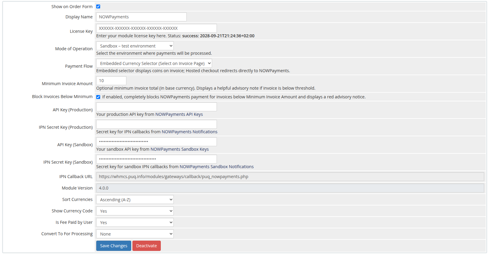

# Gateway Configuration

### NOWPayments Payment Gateway module **[WHMCS](https://puqcloud.com/link.php?id=77)**
#####  [Order now](https://puqcloud.com/whmcs-payment-gateways.php) | [Download](https://download.puqcloud.com/WHMCS/gateways/PUQ_WHMCS_PG-nowpayments/) | [Community](https://community.puqcloud.com/)

## Activate Payment Gateway in WHMCS

1. Log in to your WHMCS Admin Area.
2. Navigate to **System Settings** → **Payment Gateways** (or **Setup** → **Payments** → **Payment Gateways** in older WHMCS versions).
3. Switch to the **All Payment Gateways** tab.
4. Locate **PUQ NOWPayments** in the list and click to activate.

---

## Configure Payment Gateway

After activating, WHMCS redirects to the **Manage Existing Gateways** tab (or navigate there directly via **System Settings** → **Payment Gateways** → **Manage Existing Gateways**). Locate the **PUQ NOWPayments** section.

*gateway-configuration.png*

Configure the following parameters:

| Parameter | Type | Description |
|-----------|------|-------------|
| **Show on Order Form** | Checkbox | Check this box to enable NOWPayments as an available payment option on customer checkouts and invoices. |
| **Display Name** | Text | The public title displayed to customers (default: `NOWPayments`). |
| **License Key** | Text | Your PUQ module license key. The validation status is displayed inline. |
| **Mode of Operation** | Dropdown | Choose between **Production – live payments** or **Sandbox – test environment**. Always test in sandbox mode before going live. |
| **Payment Flow** | Dropdown | Choose between **Embedded Currency Selector** (customer selects coin on WHMCS invoice) and **Direct Hosted Checkout** (customer redirects to NOWPayments checkout). |
| **Minimum Invoice Amount** | Text (Number) | Optional minimum invoice total in your WHMCS base currency. If set, invoices below this value display an advisory notice. |
| **Block Invoices Below Minimum** | Checkbox | When enabled, completely blocks payment processing for invoices below the minimum amount and displays a red notice asking the client to select another payment method. |
| **API Key (Production)** | Password | Production API Key from your [NOWPayments Production Store Settings](https://account.nowpayments.io/store-settings#keys). |
| **IPN Secret Key (Production)** | Password | Production IPN Secret Key from [NOWPayments Notifications](https://account.nowpayments.io/store-settings#notifications). |
| **API Key (Sandbox)** | Password | Sandbox API Key for development/testing from [NOWPayments Sandbox Keys](https://account-sandbox.nowpayments.io/store-settings#keys). |
| **IPN Secret Key (Sandbox)** | Password | Sandbox IPN Secret Key from [NOWPayments Sandbox Notifications](https://account-sandbox.nowpayments.io/store-settings#notifications). |
| **IPN Callback URL** | Read-only | Automatically generated webhook endpoint URL. Copy this into your NOWPayments dashboard settings. |
| **Module Version** | Read-only | Displays the currently installed module version (e.g. `4.0.0`). |
| **Sort Currencies** | Dropdown | Sorting order for coins in the dropdown: `Ascending (A-Z)`, `Descending (Z-A)`, or `Do Not Sort (Merchant Default)`. |
| **Show Currency Code** | Dropdown | Choose `Yes` to display ticker symbols next to names (e.g. `Bitcoin (BTC)`). |
| **Is Fee Paid by User** | Dropdown | Choose `Yes` if the customer pays the gateway commission fee, or `No` if absorbed by merchant. |
| **Convert To For Processing** | Dropdown | Optional WHMCS setting to convert invoice amounts into a selected currency prior to processing. |

Click **Save Changes** at the bottom of the page.

---

## Webhook / IPN Setup in NOWPayments

To receive automated payment confirmations:

1. Copy the **IPN Callback URL** shown in your WHMCS gateway settings:
   `https://yourdomain.com/modules/gateways/callback/puq_nowpayments.php`
2. Open your NOWPayments account settings:
   - For Production: [https://account.nowpayments.io/store-settings#notifications](https://account.nowpayments.io/store-settings#notifications)
   - For Sandbox: [https://account-sandbox.nowpayments.io/store-settings#notifications](https://account-sandbox.nowpayments.io/store-settings#notifications)
3. Paste the callback URL and ensure the generated **IPN Secret** matches the secret entered in WHMCS.
4. Click **Save Changes**.

> **Important:** The webhook callback URL must be publicly accessible over HTTPS so that NOWPayments servers can post real-time IPN notifications to your WHMCS.
