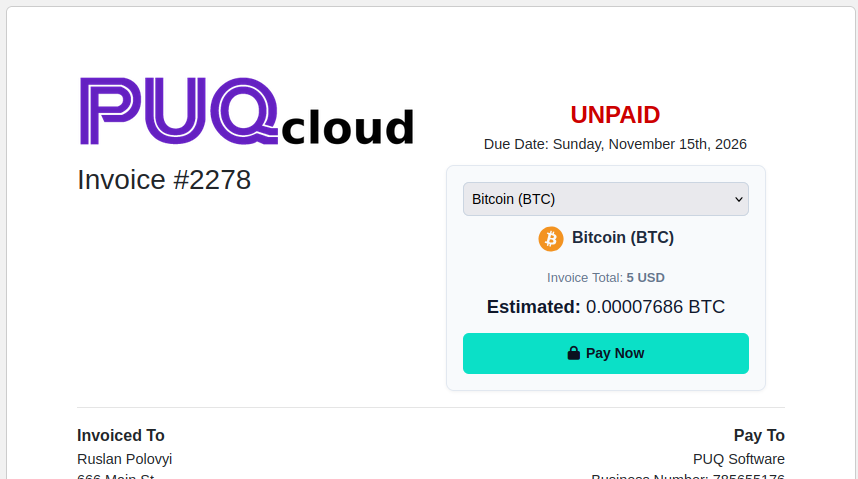
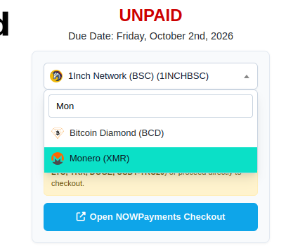
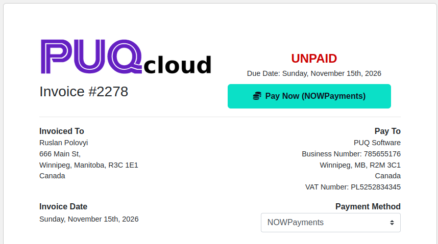
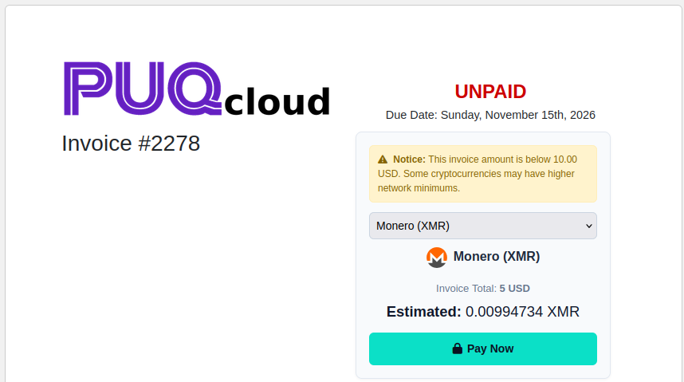
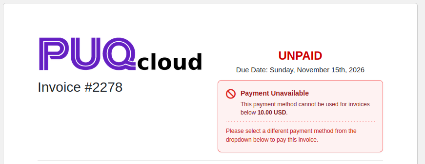

# Payment Flow

### NOWPayments Payment Gateway module **[WHMCS](https://puqcloud.com/link.php?id=77)**
#####  [Order now](https://puqcloud.com/whmcs-payment-gateways.php) | [Download](https://download.puqcloud.com/WHMCS/gateways/PUQ_WHMCS_PG-nowpayments/) | [Community](https://community.puqcloud.com/)

When a customer opens their unpaid invoice in WHMCS and selects NOWPayments, they are presented with an intuitive payment interface designed for fast, transparent, and secure cryptocurrency checkout.

## How the Payment Process Works

1. The client selects **NOWPayments** as the payment method during checkout or on an unpaid invoice.
2. The dynamic currency selector queries the NOWPayments API and displays available cryptocurrencies with real-time rate estimates.
3. The client selects their desired coin and clicks **Pay Now** (or clicks **Pay Now (NOWPayments)** in hosted checkout mode).
4. The client is redirected to the secure NOWPayments checkout page displaying the exact crypto payment address and QR code.
5. The client submits the transaction from their crypto wallet.
6. The blockchain network confirms the transaction, and NOWPayments sends an Instant Payment Notification (IPN) webhook.
7. WHMCS validates the HMAC-SHA512 cryptographic signature and records the transaction.
8. The invoice is automatically marked as **Paid**, and all details are recorded in the WHMCS transaction logs.

```
[Customer opens invoice]
        │
        ▼
[Currency Selector loads available coins from NOWPayments API]
        │
        ▼
[Real-time rate calculation via /v1/estimate]
        │
        ▼
[Customer clicks "Pay Now" -> Redirected to NOWPayments Checkout]
        │
        ▼
[Customer sends transaction from their Crypto Wallet]
        │
        ▼
[Blockchain confirms payment -> NOWPayments posts IPN to WHMCS]
        │
        ▼
[HMAC Verification -> addInvoicePayment -> Invoice marked Paid]
```

---

## Payment Interface Options

### 1. Embedded Currency Selector
The default checkout interface embeds live coin calculation directly on the WHMCS invoice view. Customers can see the exact estimated amount in cryptocurrency before proceeding:


*embedded-currency-selector.png*

### 2. Searchable Select2 Cryptocurrency Dropdown
The module embeds a responsive Select2 dropdown with coin icons and instant keyboard filtering. Customers can easily find any of the 200+ supported coins by typing its name or ticker:


*select2-searchable-coins.png*

### 3. Direct Hosted Checkout Flow
For merchants who prefer not to display coin selection on the WHMCS invoice, the module can be configured in **Direct Hosted Checkout** mode:


*hosted-checkout-button.png*

Clicking the button immediately redirects the customer to NOWPayments where all available coins are presented.

---

## Threshold Management (Micro-invoices)

Cryptocurrency networks require miner fees, which impose minimum deposit thresholds (typically $7-$15 for BTC/ETH, and $1-$2 for LTC/TRX). To prevent client frustration, the module provides two threshold management modes:

### Advisory Notice Mode
When an invoice is below the configured **Minimum Invoice Amount** and strict blocking is disabled, an informational advisory is shown to guide the customer:


*payment-warning-below-minimum.png*

### Strict Blocking Mode
When **Block Invoices Below Minimum** is enabled in gateway settings, invoices below the threshold display a prominent red warning notice and lock payment buttons, prompting the client to choose an alternative payment method:


*payment-block-below-minimum.png*

---

## Callback / Webhook Setup

On your NOWPayments merchant dashboard, configure the IPN callback URL:

`https://yourdomain.com/modules/gateways/callback/puq_nowpayments.php`

- The callback script verifies the HMAC-SHA512 signature against the configured IPN Secret Key.
- Once verified and marked `finished`, the module:
  - Ensures the transaction has not already been applied.
  - Converts the paid amount to the client's currency if necessary.
  - Calls WHMCS internal `addInvoicePayment` to mark the invoice **Paid**.
  - Logs complete audit details in WHMCS **Billing** → **Transactions**, **Utilities** → **Logs** → **Gateway Log**, and **Module Log**.
