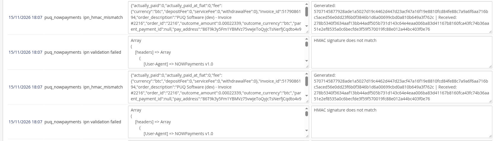
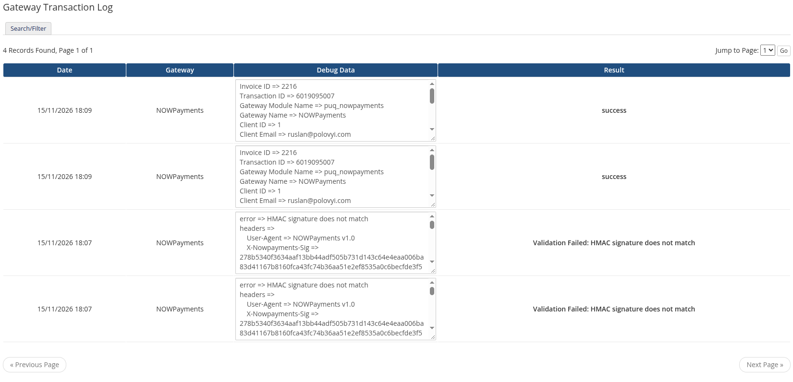
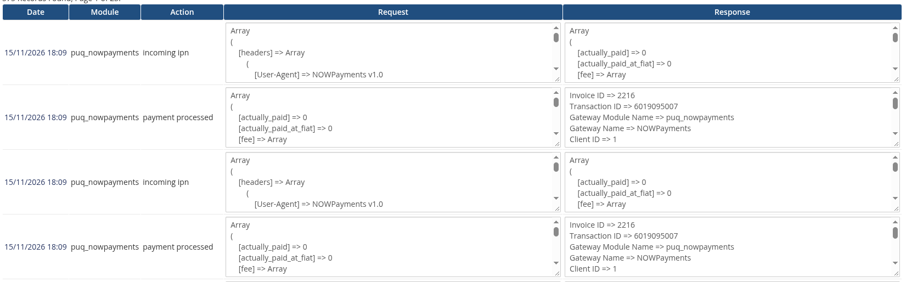

# Troubleshooting

### NOWPayments Payment Gateway module **[WHMCS](https://puqcloud.com/link.php?id=77)**
#####  [Order now](https://puqcloud.com/whmcs-payment-gateways.php) | [Download](https://download.puqcloud.com/WHMCS/gateways/PUQ_WHMCS_PG-nowpayments/) | [Community](https://community.puqcloud.com/)

---

## 1. Invoices Under $7-8 Fail to Load Payment Methods

### Problem Description
When viewing an invoice in WHMCS whose total is less than approximately $7.00 - $8.00 USD, the currency estimator fails or displays an error indicating that the amount is below the minimum limit.

### Why This Occurs
- **Cryptocurrency Network Limits:** Cryptocurrencies require network mining fees and exchange liquidity buffers. For top assets like **Bitcoin (BTC)** and **Ethereum (ETH)**, NOWPayments requires a minimum payment threshold of typically **$7.00 to $15.00 USD**.
- If a customer or the selector defaults to BTC on an invoice of $3.00, the NOWPayments API returns an error (`AMOUNT_MIN_LIMIT: Amount is less than minimum`).
- If your NOWPayments merchant account only has BTC or ETH enabled in your *Coins Settings*, the NOWPayments hosted page will have no available currencies that support micro-invoices under $7.00.

### Solution & Best Practices
1. **Enable Low-Minimum Cryptocurrencies:** In your [NOWPayments Dashboard > Coins Settings](https://account.nowpayments.io/coins-settings), ensure you enable cryptocurrencies that feature very low network fees and micro-minimums (typically **$1.00 - $2.00 USD**):
   - **Litecoin (LTC)**
   - **TRON (TRX)**
   - **Tether on TRON (USDTTRC20)**
   - **Dogecoin (DOGE)**
   - **Solana (SOL)**
   - **Binance Coin (BNB / BSC)**
2. **Module Guidance:** In v4.0.0+, if a customer selects a currency whose minimum is above the invoice amount, the module displays the exact minimum threshold returned by the API and advises the customer to select an alternative low-fee coin.
3. **Use Direct Hosted Flow:** You can switch the module setting **Payment Flow** to **Direct Hosted Checkout**. This passes an open invoice to NOWPayments without pre-fixing the currency, allowing NOWPayments to display only the coins eligible for that specific amount.
4. **Set Minimum Invoice Amount:** In the module settings, configure **Minimum Invoice Amount** (e.g. `5.00` or `8.00`). If an invoice is below this threshold, a notice is displayed, guiding the customer, or strict blocking can be enabled.

---

## 2. IPN Signature Does Not Match

### Symptoms
Payments confirm on the blockchain, but the WHMCS invoice remains in **Unpaid** status. The Gateway Log or Module Log displays an `HMAC Signature Mismatch` error:

*module-log-hmac-mismatch.png*

### Resolution
1. Verify whether your gateway is configured in **Production** or **Sandbox** mode.
2. Confirm that the **IPN Secret Key** in WHMCS strictly matches the secret configured in your NOWPayments account for that environment:
   - Production Secret: [https://account.nowpayments.io/store-settings#notifications](https://account.nowpayments.io/store-settings#notifications)
   - Sandbox Secret: [https://account-sandbox.nowpayments.io/store-settings#notifications](https://account-sandbox.nowpayments.io/store-settings#notifications)
3. Ensure no trailing or leading whitespace is present in the copied key.
4. The module automatically tests all configured IPN secrets (active mode, production secret, and sandbox secret) to guarantee valid signature resolution.

---

## 3. Webhook Callback Not Reaching WHMCS

### Symptoms
No callback entries appear in **Billing** → **Gateway Log** after a customer completes a payment.

### Resolution
1. Ensure your server firewall (UFW, iptables, Cloudflare, ModSecurity) does not block incoming POST requests to `/modules/gateways/callback/puq_nowpayments.php`.
2. Ensure your SSL/TLS certificate is valid and not expired. NOWPayments requires valid HTTPS certificates to send webhook notifications.
3. In your NOWPayments dashboard under Notifications, verify that the webhook URL is saved correctly and test the connection.

---

## 4. Inspecting Logs & Audit Trail

### WHMCS Gateway Log
Whenever NOWPayments delivers a callback, an entry is added to **Billing** → **Gateway Log** (or **Utilities** → **Logs** → **Gateway Log**):

*gateway-transaction-log.png*

### WHMCS Module Log
For detailed API tracing with sanitized sensitive keys:
1. In the WHMCS Admin Area, navigate to **Utilities** → **Logs** → **Module Log**.
2. If module logging is not already enabled, click **Enable Debug Logging**.
3. Search for entries with Gateway `puq_nowpayments` to inspect raw queries, live estimates, and webhook payloads:

*module-log-payment-processed.png*
