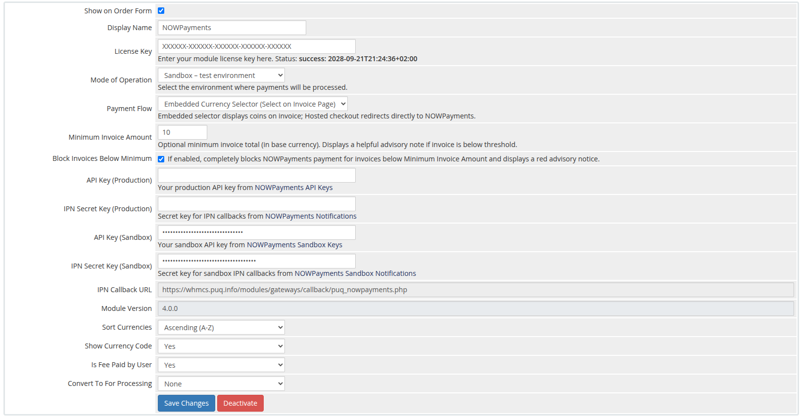
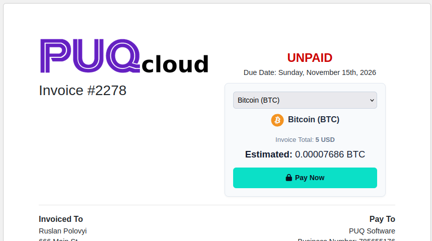

# Description

### NOWPayments Payment Gateway module **[WHMCS](https://puqcloud.com/link.php?id=77)**
#####  [Order now](https://puqcloud.com/whmcs-payment-gateways.php) | [Download](https://download.puqcloud.com/WHMCS/gateways/PUQ_WHMCS_PG-nowpayments/) | [Community](https://community.puqcloud.com/)

The PUQ NOWPayments Payment Gateway module for WHMCS allows hosting providers and online businesses to accept over 200 cryptocurrencies directly on customer invoices with automatic real-time rate conversion, secure IPN callback verification, and instant balance settlement.

## Key Features

- **200+ Cryptocurrencies Supported:** Accept Bitcoin (BTC), Ethereum (ETH), Litecoin (LTC), TRON (TRX), Tether (USDT), Dogecoin (DOGE), and hundreds of other coins.
- **Searchable Currency Dropdown:** Powered by Select2 with coin logos, ticker symbols, and instant keyboard search.
- **Dynamic Real-Time Rate Estimation:** Live exchange rate estimates fetched directly via NOWPayments API.
- **Configurable Payment Flows:** Choose between an embedded invoice currency selector or direct hosted checkout redirection.
- **Minimum Invoice Threshold Management:** Set custom minimum amounts to advise clients or strictly block micro-invoices below network fee limits.
- **Automated IPN Webhooks:** Instant invoice payment processing with HMAC-SHA512 cryptographic verification.
- **Comprehensive Logging:** Dedicated entries in WHMCS Gateway Log and Module Log with sanitized and masked API credentials.
- **Multi-Currency Settlement:** Automatic conversion into the client's account currency and base WHMCS currency.
- **Multi-Language Support:** Fully localized into all 27 languages supported by WHMCS.

## System requirements

| Requirement | Minimum |
|-------------|---------|
| **WHMCS** | 8.x+, 9.x+. |
| **PHP** | 7.4, 8.1, 8.2, 8.3, 8.4 |
| **ionCube Loader** | v15+ |

---

## Available Options in Admin Panel

- Configure API credentials for production and sandbox environments.
- Set IPN secret keys for secure callback validation.
- Switch seamlessly between live production and sandbox test environments.
- Automatic webhook callback endpoint URL generation.
- Choose preferred checkout flow (Embedded currency selector vs Direct hosted checkout).
- Configure optional minimum invoice threshold to guide customers on micro-payments.
- Enable strict blocking mode to prevent payment attempts on invoices below minimum threshold.
- Sort available cryptocurrencies (Ascending, Descending, None) and toggle currency codes.
- Choose whether gateway transaction fees are absorbed by the merchant or paid by the customer.
- Inline license key validation and dashboard notification alerts.

## Available Options in Client Panel

- Select from 200+ cryptocurrencies with instant search and coin logos.
- View real-time exchange rates and exact payment amounts before proceeding.
- Clear advisories and recommendations for low-fee coins (LTC, TRX, DOGE, USDT-TRC20) when invoices fall below network minimums.
- Clear notifications when invoices fall below merchant-configured minimum thresholds.
- Direct redirection to secure NOWPayments hosted payment page.
- Instant invoice status update to **Paid** upon blockchain confirmation.

---

## Links

- **Product page:** [https://puqcloud.com/whmcs-payment-gateways.php](https://puqcloud.com/whmcs-payment-gateways.php)
- **Documentation:** [https://doc.puq.info/books/nowpayments-payment-gateway-whmcs-module](https://doc.puq.info/books/nowpayments-payment-gateway-whmcs-module)
- **Support:** [https://puqcloud.com/submitticket.php](https://puqcloud.com/submitticket.php?step=2&deptid=1)
- **Community:** [https://community.puqcloud.com/](https://community.puqcloud.com/)

---

> **Note:** The module supports both production and sandbox environments. Make sure to use the correct API keys and IPN secret keys for your selected environment. Sandbox keys are available at [NOWPayments Sandbox](https://account-sandbox.nowpayments.io/store-settings#keys) and production keys at [NOWPayments Production](https://account.nowpayments.io/store-settings#keys).

> **Note:** Please ensure that the webhook callback URL is configured in your NOWPayments account settings. The module automatically provides the correct callback URL in the configuration. Ensure that your server can receive incoming webhook notifications from NOWPayments servers.

*gateway-configuration.png*

*embedded-currency-selector.png*
